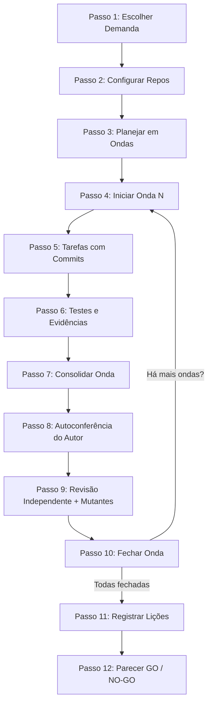

# Executar Demanda em Ondas

Framework rigoroso para agentes de IA e desenvolvedores que planeja, executa e valida demandas, *features* e projetos de software em **ondas estruturadas** com **Quality Gates mecânicos**.

Diferente de fluxos baseados apenas em prompts ou instruções livres, aqui **nenhum gate depende da memória ou da boa vontade da IA**. A conformidade de cada etapa é verificada e atestada por scripts locais em Python através de *fingerprints* reais do Git, árvores de dependência, suítes de testes, testes de mutação e revisão independente.

---

## 🚀 Princípios Fundamentais

1. **"O modelo julga, o script contabiliza"**: A IA toma decisões técnicas e elabora código, mas apenas scripts determinísticos aprovam commits, transições de ondas e liberações.
2. **Fingerprint de Conteúdo**: A prova de que um teste ou revisão é válido está vinculada ao *hash* exato do conteúdo do repositório no momento em que ocorreu. Commitar sem alterar arquivos ou fabricar evidências não vence gates.
3. **Falas Reais do Usuário**: Toda decisão que flexibiliza escopo ou aprova planos exige citação textual exata registrada pelo coletor de *hooks* no terminal. A IA não pode inventar aprovações.
4. **Testes de Mutação em Scratch Isolado**: Injeta defeitos deliberados em uma cópia (*git worktree*) descartável para certificar que a suíte de testes realmente detecta regressões.
5. **Revisor Independente (4 Olhos)**: Quem implementa realiza autoconferência, mas a aprovação da onda requer um subagente dedicado e independente, avaliando código e testes do zero.
6. **Parecer de Liberação GO / NO-GO**: Ao final de todas as ondas, gera um parecer formal consolidando histórico, testes, mutantes mortos, decisões de engenharia e pendências.

---

## 🧩 Compatibilidade Multi-Agente

Projetado de forma universal para operar nativamente nos principais ecossistemas de agentes de código:

| Ecossistema | Interação com Usuário | Subagente Revisor | Formato de Skill |
| :--- | :--- | :--- | :--- |
| **Google Gemini (Antigravity)** | `ask_question` | `invoke_subagent (self)` | Plugin / Global Skill |
| **Codex (OpenAI)** | `request_user_input` | `collaboration.spawn_agent` | Global Skill / Hook |
| **Claude Code (Anthropic)** | `AskUserQuestion` | `Agent (general-purpose)` | Global Skill / Hook |

Compatível com **Windows nativo** (PowerShell / CMD) e **Linux / macOS** (Bash / Zsh).

---

## 📁 Estrutura do Repositório

```text
executar-demanda/
├── plugin.json                       # Manifesto de plugin para Antigravity
├── hooks.json                        # Registro de hooks de ciclo de vida (Antigravity/Codex)
├── SKILL.md                          # Instruções da skill para agentes
├── skills/
│   └── executar-demanda/
│       └── SKILL.md                  # Espelho para carregamento por plugins
├── hooks/
│   └── registrar-fala-usuario.py     # Coletor universal de prompts e respostas
├── scripts/
│   ├── demanda.py                    # CLI principal de gates e comandos
│   ├── comum.py                      # Utilitários de git, travas multiplataforma e falas
│   ├── plano.py                      # Validação e selamento de planos
│   ├── decisoes.py                   # Livro de decisões ancoradas em falas
│   ├── onda.py                       # Gestão do ciclo de vida das ondas
│   ├── commit.py                     # Commits rastreáveis por tarefa
│   ├── testes.py                     # Execução de testes e registro de evidências
│   ├── mutantes.py                   # Injeção de mutantes em worktree temporária
│   ├── revisao.py                    # Gestão de autoconferência e revisão independente
│   ├── parecer.py                    # Emissão de parecer final GO / NO-GO
│   ├── estado.py                     # Reconciliação e geração do painel
│   ├── grafo.py                      # Grafo de rastreabilidade (requisitos → plano → código)
│   ├── licoes.py                     # Base de lições aprendidas por repositório
│   ├── autoteste.py                  # Suíte completa de verificação mecânica dos gates
│   └── autoteste_windows.py          # Regressão multiplataforma e testes de hooks
├── referencias/                      # Guias detalhados de cada fase da metodologia
│   ├── planejar.md
│   ├── executar-onda.md
│   ├── revisor.md
│   ├── mutantes.md
│   ├── parecer.md
│   ├── formatos.md
│   ├── problemas.md
│   ├── licoes.md
│   ├── painel.md
│   └── retomar.md
└── assets/painel/                    # Dashboard HTML/CSS/JS interativo
```

---

## 📦 Como Instalar Globalmente

Clone este repositório no local de sua preferência (ex: `C:\dev\skills\executar-demanda`):

```bash
git clone https://github.com/joaovictorr07/executar-demanda.git C:\dev\skills\executar-demanda
```

### 1. No Google Gemini / Antigravity

Adicione a declaração explícita em `~/.gemini/config/skills.json` (ou `plugins.json`):

```json
{
  "entries": [
    {
      "path": "C:/dev/skills"
    }
  ]
}
```

Ou crie uma junção NTFS diretamente na pasta de plugins do Antigravity:

```powershell
New-Item -ItemType Junction -Path "$HOME\.gemini\config\plugins\executar-demanda" -Target "C:\dev\skills\executar-demanda"
```

### 2. No Codex

Crie uma junção NTFS na pasta de skills do Codex:

```powershell
New-Item -ItemType Junction -Path "$HOME\.codex\skills\executar-demanda" -Target "C:\dev\skills\executar-demanda"
```

E registre o coletor no seu `~/.codex/hooks.json`.

### 3. No Claude Code

Crie a ligação simbólica para a pasta de skills do Claude:

```bash
ln -s /caminho/para/executar-demanda ~/.claude/skills/executar-demanda
```

---

## 🔄 Fluxo de Execução em Ondas

A metodologia organiza a entrega em 12 passos rastreáveis:



### Resumo dos Comandos Principais

```powershell
# Atalhos úteis (PowerShell)
$PY = (Get-Command python).Source
$D = 'C:\dev\skills\executar-demanda\scripts\demanda.py'

# 1. Configurar repositórios da demanda
& $PY $D configurar "<pasta-demanda>" --repo api --caminho "C:/projeto/backend" --perfil maven
& $PY $D configurar "<pasta-demanda>" --repo web --caminho "C:/projeto/frontend" --perfil angular

# 2. Validar e aprovar o plano
& $PY $D validar-plano "<pasta-demanda>"
& $PY $D aprovar-plano "<pasta-demanda>" --citacao "<trecho literal dito pelo usuário>"

# 3. Ciclo da onda
& $PY $D iniciar-onda "<pasta-demanda>" 1
& $PY $D testar "<pasta-demanda>" --repo api --classes 'MinhaClasseTest'
& $PY $D commit "<pasta-demanda>" --tarefa T1.1 -m "Implementa regra de cálculo"

# 4. Mutantes em scratch isolado
& $PY $D mutante preparar "<pasta-demanda>" --repo api
& $PY $D mutante aplicar "<pasta-demanda>" --arquivo src/main/Calc.java --linha 42 --de '*' --para '/' --aceite A1.1 --testes 'CalcTest' --descricao 'Inverte operador'
& $PY $D mutante limpar "<pasta-demanda>"

# 5. Revisão e Fechamento
& $PY $D autoconferencia validar "<pasta-demanda>" 1
& $PY $D revisao iniciar "<pasta-demanda>" 1
& $PY $D fechar-onda "<pasta-demanda>" 1

# 6. Parecer Final e Dashboard
& $PY $D parecer iniciar "<pasta-demanda>"
& $PY $D parecer validar "<pasta-demanda>"
& $PY $D estado painel "<pasta-demanda>" --html
```

---

## 🧪 Validação dos Scripts e Gates

O framework inclui suítes completas de testes automatizados:

```powershell
# Executa testes unitários rápidos de integração Windows, Gemini e Codex
python scripts/autoteste_windows.py

# Executa suíte completa exercitando todos os gates ponta a ponta
python scripts/autoteste.py
```

---

## 📄 Licença

Distribuído sob licença aberta (MIT / Apache 2.0). Sinta-se livre para usar, adaptar e estender para seus projetos pessoais ou corporativos.
